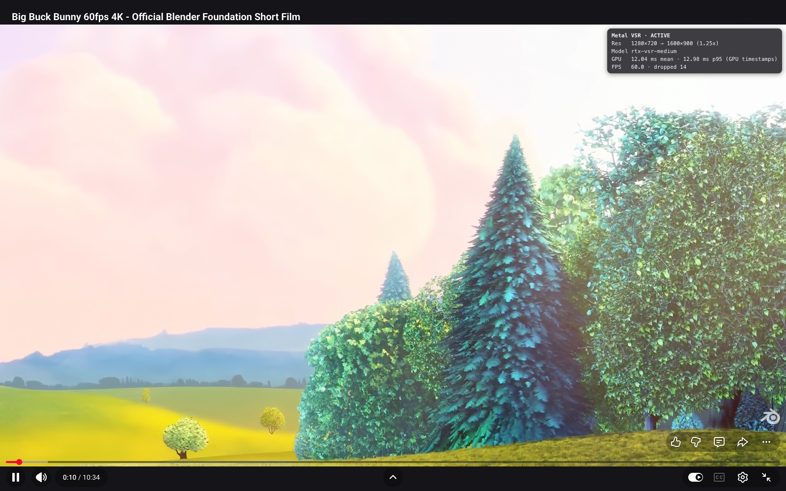
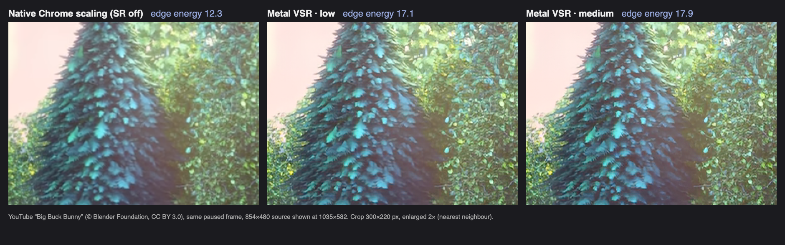

# WebGPU VSR

WebGPU VSR is a personal Chrome Manifest V3 extension for Apple Silicon Macs. It runs a
reconstruction of NVIDIA RTX Video Super Resolution's low and medium networks in WebGPU
compute shaders and draws the upscaled picture under the page's own video controls.
This is an independent personal project, not affiliated with or endorsed by NVIDIA.



Video shown: Big Buck Bunny, (c) Blender Foundation, CC BY 3.0.

## Before and after



The same paused YouTube frame in Google Chrome 156 on an M5 Max: an 854×480 source shown in a
1035×582 player (1.21× upscale). Left: Chrome's own scaling with the extension off; middle and
right: WebGPU VSR low and medium. The 300×220 px crop is enlarged 2× with nearest-neighbour
scaling. Mean luma gradient magnitude ("edge energy") of the crop: 12.3 native, 17.1 low
(+39%), 17.9 medium (+46%). Larger upscale factors (theater mode, fullscreen) show a bigger
difference. The extension only processes a video displayed at least 1.15× larger than its
source; otherwise the page's own picture is left as is.

## Features

- Low and medium reconstructed networks, plus Quality 0 Catmull-Rom bicubic resampling (**Basic** in the popup).
- GPU processing driven by decoded video frames, without CPU pixel readbacks.
- Picture-only hiding that preserves native controls, WebVTT captions and pointer input.
- Player resize, theater mode and container fullscreen support, with a 4K (3840x2160) output ceiling.
- Automatic quality downgrade when processing misses frame deadlines; native playback on failure.
- Popup settings, a per-site switch and an optional performance HUD.
- A separate native Metal benchmark covering low, medium, high and ultra float models.

## Requirements

- macOS on Apple Silicon.
- Chrome with WebGPU and `shader-f16` for the neural models. Without `shader-f16`, the
  implementation runs Quality 0 without that feature.
- Tested browser generation: Chrome / Chromium 156. The manifest minimum is Chrome 135;
  versions other than 156 have not been validated.
- For building: Node.js and npm. The documented build environment uses Node 26.

## Install

WebGPU VSR is not in the Chrome Web Store. Chrome installs it as an **unpacked extension**
(Developer mode). Google Chrome does not accept `.crx` files from outside the Web Store,
so every release ships a zip that you unpack and load.

### Option A: install from a GitHub release (recommended)

1. Open the repository's **Releases** page and download `webgpu-vsr-<version>.zip` from the
   latest release (for example `webgpu-vsr-1.1.0.zip`).
2. Unzip it into a folder that will stay where it is, for example
   `~/Applications/webgpu-vsr`. Chrome loads the extension from this folder every time it
   starts, so do not delete or move it afterwards.

   ```sh
   mkdir -p ~/Applications/webgpu-vsr
   unzip -o ~/Downloads/webgpu-vsr-1.1.0.zip -d ~/Applications/webgpu-vsr
   ```

   The folder must contain `manifest.json` directly (not inside another subfolder).
3. In Chrome, open `chrome://extensions`.
4. Turn on **Developer mode** (toggle in the top-right corner).
5. Click **Load unpacked** and select the folder from step 2
   (`~/Applications/webgpu-vsr`). In the file dialog, press **Cmd+Shift+G** and paste the
   path if the folder is hidden.
6. Chrome shows **WebGPU VSR - Video Super Resolution** in the list. Click the puzzle icon in
   the toolbar and pin the extension so its popup and badge are visible.

### Option B: build from source

Requires Node.js and npm (developed with Node 26).

```sh
git clone https://github.com/wyanzhao/webgpu-vsr.git
cd webgpu-vsr/extension
npm ci
npm run build
```

Then follow steps 3-6 of option A, selecting `extension/dist` in this checkout. After
rebuilding, click the reload icon on the extension's card in `chrome://extensions`. The
committed bundles in `extension/public/weights/` are copied by the build; weight conversion
is not needed for installation.

### Check that it works

1. Open a video page, for example a YouTube video at 480p or 720p in a player that is
   larger than the video (theater mode or fullscreen for 720p).
2. Click the extension icon: **Video super resolution** should be on, and the video list
   should show the video as active.
3. Turn on **Performance HUD** in the popup: a small panel over the video shows the source
   and output resolution, the model (`rtx-vsr-low` / `rtx-vsr-medium`), GPU time and frame
   rate.
4. If the video stays native, the popup shows the reason (for example `no-upscale-needed`
   when the player is not at least 1.15x larger than the video). See *Limitations*.

### Update

- Release install: download the new zip, unzip it over the same folder
  (`unzip -o ... -d ~/Applications/webgpu-vsr`), then click the reload icon on the
  extension's card in `chrome://extensions`. Settings are kept.
- Source install: `git pull`, `npm ci`, `npm run build`, then reload the extension.

### Uninstall

Click **Remove** on the extension's card in `chrome://extensions`, then delete the folder.

### Troubleshooting

- **"Disable developer mode extensions" prompt at Chrome startup:** Chrome shows this for
  every unpacked extension. Choose to keep it.
- **Popup reports WebGPU unavailable:** open `chrome://gpu` and check that WebGPU is
  "Hardware accelerated". Chrome 135 or newer on an Apple Silicon Mac is required.
- **Errors button on the extension's card:** click it to see the extension's log, or open
  the video page's DevTools console and filter for `webgpu-vsr`.
- **A page looks wrong:** turn off **Enable on this site** in the popup. Processing stops at
  once and the page's own video is restored (see *Limitations*).

Chrome shows a “Read your browsing history” warning for the `tabs` permission, which is
used to identify the current tab and its site. The bundled weights are web-accessible
extension resources without `use_dynamic_url`. Both are accepted trade-offs for a
personal-use extension.

## Usage

Open a video page and click the extension icon:

- **Video super resolution** enables or disables processing globally.
- **Enable on this site** controls the current tab's hostname, including embedded players
  when the top-level site is disabled. Disabling globally or for a site removes the canvas
  and HUD and restores native playback.
- **Quality** selects 0 (bicubic), 1 (low) or 2 (medium). Low is the default; the choice is
  a ceiling for the automatic downgrade controller.
- **Sharpness** scales the learned residual from 0 to 1. The default, 0.5, is the network's
  native output. Quality 0 has no learned residual and is unaffected by this control.
- **Performance HUD** shows the resolution, active model, GPU time, frame rate and drops.
  It stays hidden when processing is disabled globally, for the frame or top-level site,
  or by the built-in site rule. The popup also lists videos in the current tab and their processing state.

Settings take effect immediately through `chrome.storage.local` change events; content scripts
ignore settings broadcast payloads. After an extension reload or removal, periodic context
checks clean up orphaned canvases and HUDs and restore native playback.

The toolbar badge reads `ON` when a video is active, `OFF` when disabled globally or for
that site, and `ERR` when no video is active and a GPU session has failed. It is empty
when no video is active or failed. It does not indicate an output resolution tier.

Processing starts only when the eligibility gate passes. If the displayed picture is
less than 1.15x the source resolution, native playback remains visible. Try a lower source
resolution or a larger player if the popup reports `no-upscale-needed`.

## How it works

1. Discovery tracks ordinary `<video>` elements, including dynamically inserted players.
2. A 9-point gate checks DRM, presentation mode, DOM geometry, CORS / taint, upscale need,
   HDR, user / site settings, WebGPU availability and frame-budget health.
3. `requestVideoFrameCallback` drives `VideoFrame` creation and `importExternalTexture`.
   One compute pass records the network dispatches and optional resample into a canvas.
4. The canvas sits immediately before and underneath the video. Once a frame is validated,
   `VideoPictureGuard` moves only the video picture out of view with `object-position`
   and clears its background. Controls and captions stay above the canvas; input reaches
   the video. Teardown restores the original presentation.
5. A deadline-based controller steps medium → low → Quality 0 → native playback when
   sustained late frames, a watchdog timeout or a full frame ring require it. GPU mean
   time alone does not trigger a downgrade. There is no automatic upgrade.

The networks use FP16 weights and stored activations with f32 convolution accumulation
and explicit half rounding. The internal network output is 2x the source; presentation
resamples when needed and caps the target at 3840x2160 while preserving aspect ratio. On a
Retina display a 720p video in a 1280x720 CSS-px player is therefore presented directly at
2560x1440, and 1080p sources are upscaled when the player is at least 1.15x larger in device pixels.
See the binding [implementation notes](docs/IMPLEMENTATION_NOTES.md) for exact contracts.

## Performance

Measured on 2026-11-01 with the production texture-to-canvas path, back-to-back frames,
GPU timestamps, 40 warm-up frames and 200 measured frames per case. These are compute-pass
costs, not decode-to-display latency. Paced playback can show higher GPU times as the GPU
clock drops. Full methods, memory accounting and parity results are in
[WebGPU benchmarks](docs/BENCHMARKS.md).

### Apple M5 Max (40-core GPU)

Cool machine; Playwright Chromium 156 headless, macOS 27.2.

| Model | Source → output | Median GPU ms | p95 GPU ms | Allocated MB |
|---|---|---:|---:|---:|
| low | 960x540 → 1920x1080 | 2.150 | 2.180 | 19.301 |
| medium | 960x540 → 1920x1080 | 4.848 | 4.943 | 37.860 |
| low | 1280x720 → 1920x1080 | 3.411 | 3.439 | 48.805 |
| medium | 1280x720 → 1920x1080 | 7.974 | 8.036 | 74.102 |
| Quality 0 | 960x540 → 1920x1080 | 0.255 | 0.256 | 0.124 |
| Quality 0 | 1280x720 → 1920x1080 | 0.255 | 0.256 | 0.124 |

Allocated MB counts pipeline buffers and the frame ring (MB = 10^6 bytes).
Under the 4K ceiling (2026-11-02, same machine): low 1920x1080 → 3840x2160 measures
6.692 ms, medium 17.233 ms, and a 720p source presented directly at 2560x1440 costs the same
as the 1080p resample path (low 3.337 ms, medium 7.861 ms); see
[WebGPU benchmarks](docs/BENCHMARKS.md#gpu-time-per-frame).
The medium 720p measurement is 7.97 ms; 6.5 ms is not a release requirement;
see the [latency study](docs/BENCHMARKS.md#latency-study-medium-1280x720--1920x1080-2026-11-01).

### Apple M6 base (12-core GPU)

Mac mini, 16 GB, macOS 27.0.1; branded Google Chrome 156.0.8078.79 headless.

| Model | Source → output | Median GPU ms | p95 GPU ms |
|---|---|---:|---:|
| low | 960x540 → 1920x1080 | 5.052 | 5.146 |
| medium | 960x540 → 1920x1080 | 13.133 | 13.205 |
| low | 1280x720 → 1920x1080 | 8.696 | 8.873 |
| medium | 1280x720 → 1920x1080 | 22.296 | 22.487 |
| Quality 0 | 960x540 → 1920x1080 | 0.718 | 0.732 |
| Quality 0 | 1280x720 → 1920x1080 | 0.720 | 0.749 |

## Validation summary

Branded Chrome playback was checked on YouTube with H.264, VP9 and AV1, on Bilibili's
ordinary video player, and on a local native-controls / WebVTT page. The M6 checks also
observed automatic downgrades from medium at 720p60. These are bounded playback checks,
not long-session guarantees. Methods, both result tables, screenshots and unvalidated
cases are in [Validation](docs/VALIDATION.md).

GPU tests compare against the reconstructed numerical contract and an independent
TypeScript reference, with exact-stage checks and negative controls. They do not establish
bit-exact agreement with NVIDIA hardware output; see
[numerical parity](docs/BENCHMARKS.md#numerical-parity-same-build).

## Hardware guidance

On base-class GPUs represented by the M6 12-core, use low up to 720p60 and medium for
30 fps content. Medium measured 13.1 ms at 540p and 22.3 ms at 720p in the benchmark.
At 720p60, low sits near the controller threshold while the page decodes and composites;
one of two M6 downgrade runs also stepped from low to Quality 0. The controller steps
down automatically when needed. The tables above describe only the measured hardware.

## Limitations

- Page CSS/DOM that reacts to extension nodes or inline values (such as `:has()`, child counts,
  generated content, attribute selectors or cousin layers revealed by insertion) is unsupported
  and may hide or alter playback; use the popup's per-site switch to remove all extension nodes
  and restore native playback.
- DRM / EME video is left untouched. Real DRM services were not validated; e2e coverage
  uses a synthetic DRM event.
- Cross-origin CDN video without CORS is left untouched and was not validated.
- HDR video is skipped by the gate and was not validated.
- Transformed or zoomed players are left untouched; pure 2D translations on ancestors are allowed.
- Fixed-position videos, static videos or parents with non-`auto` positioning offsets, and
  videos with `backdrop-filter` / `-webkit-backdrop-filter` are left untouched.
- Slotted videos and videos with `clip-path`, masks, blending or `object-view-box` are left
  untouched (`unsupported-layout`). Computed opacity and filter are mirrored during geometry
  sync; rounded corners clip to the content box, including letterboxing and object-fit cropping.
- Inset video shadows, outlines with negative offsets, and nonzero video `order` inside flex or
  grid parents are unsupported. These effects are checked at the gate and during geometry sync.
- Canvas insertion or video-position patching that changes video/sibling geometry or computed
  visibility/stacking styles is rolled back. The video remains `unsupported-layout` until its
  source or parent changes. Picture and position overrides suppress transitions while writing
  and flushing styles, then restore the page's transition declaration.
- Fullscreen of the bare `<video>` element, including through open shadow roots, turns SR off;
  fullscreen of a composed ancestor is supported.
  Picture-in-Picture is also excluded by the gate.
- Bilibili `bwp-video` HEVC WASM elements are not `<video>` and are not processed.
- Other Chrome versions, long sessions and thermal behaviour have not been validated.
  Power measurement is out of scope.
- The browser path supports low and medium only and caps output at 4K. High and ultra
  are available only in the native benchmark; on a nine-clip quality set they were not
  measurably better than medium at 2.3x and 5.0x its cost
  ([quality comparison](docs/NATIVE_BENCHMARK.md#quality-comparison---quality)).

## Development

From `extension/`, install the test browser once:

```sh
npx playwright install chromium
```

On macOS, Playwright stores the browser in `~/Library/Caches/ms-playwright`.

From `extension/`:

```sh
npm run build
npm run typecheck
npm run lint
npm run test:unit
npm run test:e2e
```

`test:e2e` builds the harness with `npm run build:harness` before running Playwright.
GPU tests need a real GPU with WebGPU; a successful software-only run is not GPU validation.
To select the benchmark alone after building the harness:

```sh
npm run build:harness
npx playwright test tests/e2e/gpu_bench.spec.ts
```

Set `PW_CHANNEL=chrome` to benchmark the installed Google Chrome instead of bundled Chromium:

```sh
PW_CHANNEL=chrome npx playwright test tests/e2e/gpu_bench.spec.ts
```

To check real sites, load the build into the installed Google Chrome and print the
extension's own per-video reports (layouts `#theater` / `#fullscreen` use YouTube's keys):

```sh
npm run build
node scripts/real_site_check.mjs --headless --dpr 2 --seconds 30 --yt-quality hd1080 "https://www.youtube.com/watch?v=aqz-KE-bpKQ#fullscreen"
```

The native quality comparison needs `ffmpeg` with libx264 and network access to the Xiph
test sequences (from the repository root):

```sh
tools/make_quality_set.sh /path/to/quality-set
native-benchmark/build/vsr-bench --quality /path/to/quality-set
```

The native tool requires Xcode's Metal toolchain and the RTX VSR research dataset:

```sh
export RTX_VSR_RESEARCH_DIR=/path/to/rtx-vsr-research   # needed to export the high/ultra models
cd ../native-benchmark && make && make validate && make bench
```

See [Native benchmark](docs/NATIVE_BENCHMARK.md) for its inputs and measured results.

## Repository layout

| Path | Contents |
|---|---|
| `extension/` | MV3 extension, popup, content controller, WGSL pipelines and tests |
| `native-benchmark/` | Standalone Swift / Metal validation and benchmark tool |
| `tools/` | Weight conversion and verification scripts |
| `docs/images/` | Playback screenshots |
| [Implementation notes](docs/IMPLEMENTATION_NOTES.md) | Binding contracts and design deviations |
| [WebGPU benchmarks](docs/BENCHMARKS.md) | Measured browser timings, memory, parity and latency study |
| [Native benchmark](docs/NATIVE_BENCHMARK.md) | Native model coverage, validation and timings |
| [Validation](docs/VALIDATION.md) | Real-site checks and scope limits |
| [AGENTS.md](AGENTS.md) | Commands, contracts and conventions for coding agents and contributors |

## Weights and legal notice

The committed weight bundles contain byte-identical NVIDIA RTX Video SDK 1.1 parameters.
They remain NVIDIA's property, are excluded from this project's license, and are included
for the copyright holder's personal use only. Do not redistribute the weights.

To regenerate and verify them from the repository root:

```sh
python3 tools/convert_weights.py && python3 tools/verify_weights.py
```

These scripts read the RTX VSR research dataset from the directory in the
`RTX_VSR_RESEARCH_DIR` environment variable (for example
`RTX_VSR_RESEARCH_DIR=/path/to/rtx-vsr-research python3 tools/convert_weights.py`). The dataset
is not part of this repository; the generated low and medium bundles are already committed
under `extension/public/weights/`.

## License

The project's own code is licensed under the [MIT License](LICENSE), copyright
2026 Yanzhao Wang. The files under `extension/public/weights/` are explicitly excluded.
