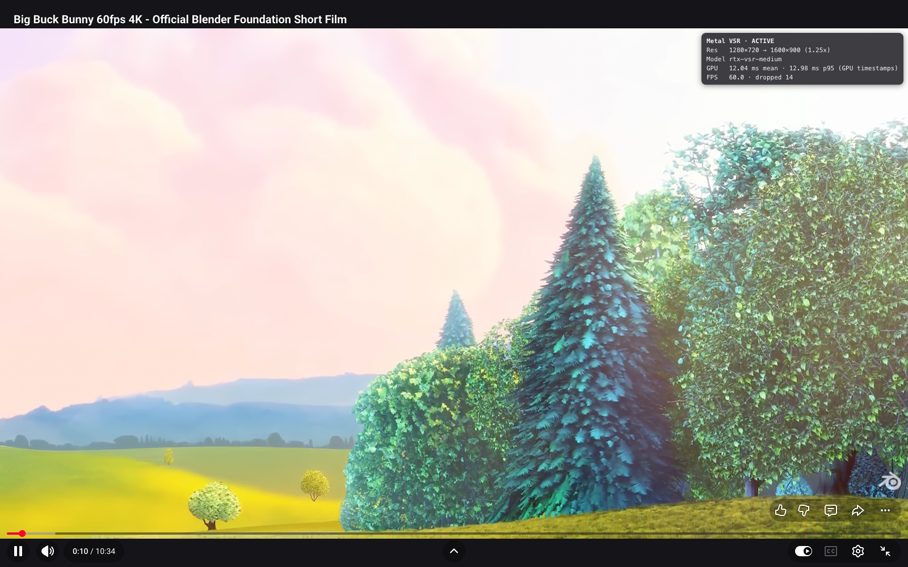
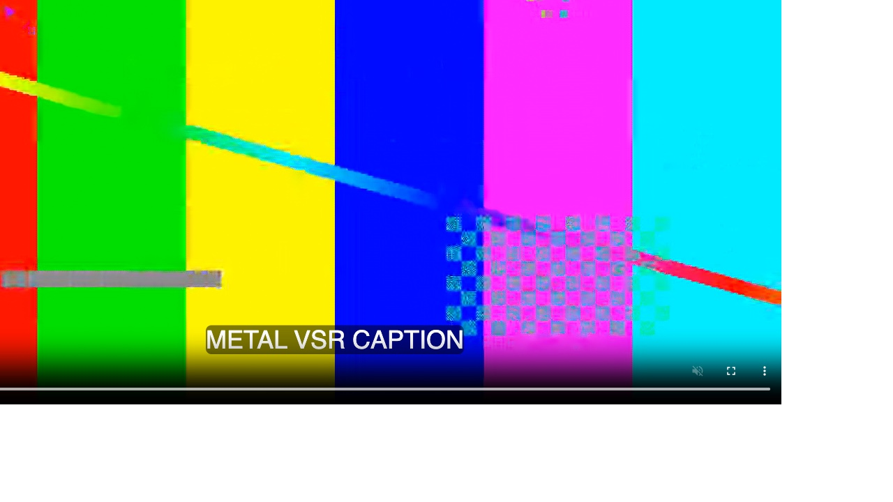

# Playback validation

These are the real-site and local-player checks recorded on 2026-11-01. They are bounded
playback observations on the environments below. Back-to-back compute benchmarks and
numerical parity are documented separately in [Benchmarks](BENCHMARKS.md); binding
behaviour is described in [Implementation Notes](IMPLEMENTATION_NOTES.md).

## Method

Playwright drove installed, branded Google Chrome with channel `chrome`, with the extension
loaded unpacked through the CDP command `Extensions.loadUnpacked`. Branded Chrome ignores
`--load-extension`; this method requires `--enable-unsafe-extension-debugging` and a pipe
connection.

The YouTube video was “Big Buck Bunny 60fps 4K” (`aqz-KE-bpKQ`). For H.264 and VP9 checks,
other codecs were hidden from `MediaSource.isTypeSupported`; AV1 was YouTube's own default
on the M5 Max. Source resolution, player size, active model, frame rate, GPU timestamps and
drops came from the extension's own reports during paced playback. A mean GPU time here
is not the saturated benchmark median: the GPU lowers its clock under paced load, and
paced times can be higher. Drops below are the reported counts for each observation, not
rates over a common duration.

## M5 Max real-site results

Apple M5 Max (40-core GPU), branded Google Chrome 156.0.8078.74, headful, extension loaded
unpacked.

| Site / codec | Source | Player | Model | Result |
|---|---|---|---|---|
| YouTube H.264 avc1.4D401F | 854x480@30 | default 1035x582 | low | active, 30 fps, GPU 5.7 ms mean, 172 frames presented |
| YouTube H.264 avc1.4D4020 | 1280x720@60 | theater 1477x831 | low | active, 60 fps, GPU 10.7 ms mean, 3 dropped of 478 |
| YouTube H.264 avc1.4D4020 | 1280x720@60 | fullscreen 1600x900 | medium | active, 59.9 fps, GPU 13.0 ms mean, 14 dropped |
| YouTube VP9 vp09.00.51.08 | 854x480@30 | default | medium | active, 30 fps, GPU 17.7 ms mean |
| YouTube VP9 vp09.00.51.08 | 1280x720@60 | fullscreen | medium | active, 60.1 fps, GPU 11.5 ms mean, 0 dropped |
| YouTube AV1 av01.0.04M.08 | 854x480@30 | default | low | active, 30 fps, GPU 5.8 ms mean |
| YouTube AV1 av01.0.08M.08 | 1280x720@60 | fullscreen | low | active, 60 fps, GPU 12.2 ms mean, 0 dropped |
| YouTube H.264 1280x720 in a 1035x582 player | — | default | — | correctly ineligible: `no-upscale-needed` (display < 1.15x source) |
| Bilibili (logged out, international) | 576x360@30 | default 1123x632 | low | active, 30 fps, GPU 5.8 ms mean; danmaku and player UI above the canvas |
| Bilibili | 640x360@30 | default | medium | active, 30 fps, GPU 7.8 ms mean |
| Local page, native `<video controls>` + WebVTT track | 960x540@30 VP9 | 1280x720 | medium | active; native control bar and caption visible above the upscaled picture |

### Release reference matrix

Two full reference-matrix runs on branded Chrome 156 and the M5 Max covered the scenarios
below. Every scenario remained active in both runs.

| Scenario | Run 1 | Run 2 |
|---|---|---|
| YouTube H.264 480p, default watch page | active | active |
| YouTube VP9 720p60, fullscreen, medium | active | active |
| YouTube AV1 720p60, theater | active | active |
| YouTube quality switch, 480p → 360p | active | active |
| YouTube SPA navigation | active | active |
| Bilibili default | active | active |
| Bilibili wide | active | active |
| Bilibili web-fullscreen | active | active |
| Bilibili fullscreen | active | active |
| Plain `<video controls>` + WebVTT page | active | active |

No YouTube ad was served during these runs, so ads remain unvalidated.

### YouTube container fullscreen



Video shown: Big Buck Bunny, (c) Blender Foundation, CC BY 3.0. YouTube's control bar,
progress bar and title stay visible above the upscaled picture in container fullscreen.
Fullscreen of the bare `<video>` element is excluded by the gate.

### Native controls and captions



Local test clip with native `<video controls>` and a WebVTT track. Picture-only hiding
keeps the control bar and caption visible, with clicks reaching the video. The canvas sits
immediately before the video at its z-index; a static video with `z-index: auto` and no offsets is made positioned while
mounted. This case is covered by
[video_overlay.spec.ts](../extension/tests/e2e/video_overlay.spec.ts).

### 4K output ceiling (2026-11-02)

[real_site_check.mjs](../extension/scripts/real_site_check.mjs) on the M5 Max with branded
Google Chrome 156, headless, a 1600x900 viewport at device scale factor 2 (a Retina-class
3200x1800 device-pixel window), the same YouTube video, the source pinned with the player's
`setPlaybackQualityRange`, 20 s of playback per row:

```sh
node scripts/real_site_check.mjs --headless --dpr 2 --seconds 20 [--quality 2] --yt-quality hd1080 URL[#theater|#fullscreen]
```

| Source | Player (device px) | Start | Result |
|---|---|---|---|
| 1920x1080@60 | default 2226x1252 | low | active low, 60 fps, GPU 12.9 ms mean, 9 dropped of 1058 presented |
| 1920x1080@60 | theater 2600x1463 | low | active low, 60 fps, GPU 12.8 ms mean, 0 dropped |
| 1920x1080@60 | fullscreen 3200x1800 | low | stepped down to Quality 0; active, 60 fps, 0 dropped |
| 1920x1080@60 | fullscreen 3200x1800 | medium | stepped down to low; active, 60 fps, GPU 12.9 ms mean, 9 dropped |
| 1280x720@60 | default 2226x1252 | medium | stepped down to low; active, 59 fps, 8 dropped |
| 1280x720@60 | fullscreen 3200x1800 | medium | active medium, presented directly at 2560x1440, 60 fps, 0 dropped |

Before the 4K ceiling the 1080p rows were `no-upscale-needed` and the 720p rows were
resampled to 1920x1080. The two fullscreen low runs at 1080p60 ended in different tiers;
paced GPU means of about 12.9 ms sit above the 11.7 ms GPU-time condition of the deadline
rule while the clock governor fills the frame interval.

## M6 base real-site results

Mac mini, Apple M6 (12-core GPU), 16 GB, macOS 27.0.1; branded Google Chrome
156.0.8078.79, headless.

| Video / player | Model | Result |
|---|---|---|
| YouTube AV1 1280x720@60 fullscreen 1600x900 | low | active, 60 fps, GPU 8.9 ms mean, 3 dropped |
| YouTube AV1 854x480@30 | medium | active, 30 fps, GPU 17.8 ms mean |
| YouTube AV1 1280x720@60 fullscreen, starting at medium | medium → low in both runs; one of two runs then reached Quality 0 | `frame budget exceeded` after ~5 s at medium; in one run low also stepped down after ~4 s |

Low at 720p60 sits at the deadline-rule threshold on this GPU: paced GPU means of
8.9–10.2 ms against an 11.7 ms limit while the page decodes and composites. This is an
observed controller outcome, not a promise that low remains active on every 720p60 page.
The controller requires sustained missed deadlines as well as GPU-time pressure; it does
not step down on mean GPU time alone. See
[Implementation Notes, section 6.3](IMPLEMENTATION_NOTES.md#63-budget-controller-budgetcontroller).

For base-class GPUs represented by the M6 12-core, the support guidance is low up to
720p60 and medium for 30 fps content. Medium measured 13.1 ms at 540p and 22.3 ms at 720p
in the [branded-Chrome benchmark](BENCHMARKS.md#m6-base-branded-chrome-benchmark).
The controller steps down automatically when needed and does not automatically upgrade.

## Not validated and gate exclusions

- Real DRM services. The gate leaves EME / DRM video alone; e2e coverage uses only a
  synthetic DRM event.
- Cross-origin CDN video without CORS. It is left alone by design.
- HDR video. It is skipped by the gate.
- Bilibili `bwp-video` HEVC WASM elements. These are not `<video>` and are not processed.
- Chrome versions other than 156. The manifest minimum is 135; only 156 has been validated.
- Long sessions and thermal behaviour. Power measurement is out of scope.

The gate also excludes Picture-in-Picture, fullscreen of the bare `<video>` element (resolved
through open shadow roots), slotted videos, and video-element `clip-path`, masks, blending or
`object-view-box` (where available), reported as `unsupported-layout`. Opacity and filter are
mirrored during geometry sync, and rounded inner content-box corners are clipped in canvas
coordinates, including negative letterbox insets and object-fit crops. Non-`none` `backdrop-filter`
and `-webkit-backdrop-filter` on the video are rejected. Static videos or parents with a non-`auto`
z-index are rejected before positioning can activate that z-index.
The canvas starts each geometry sync with `all: initial !important`, followed by the overlay's
important longhands. Computed display, transforms (including rotate, scale and translate), clip,
mask-image, blending and zoom (where exposed) are checked alongside the mirrored styles; a mismatch
restores the native picture and reports `unsupported-layout`.
Stale IntersectionObserver bounds (more than 1 CSS px from the current rect) trigger at most one
unobserve/observe per stale target per sync. The native picture remains visible until fresh
passing entries for both targets arrive; a fresh failing pair remains unsupported. Cached bounds
are also checked on the first picture hide. Unit tests cover page canvas rotation, an unoverridable
rotation, stale observations after movement, fresh passing and failing pairs, and static negative
z-index videos inside positioned black parents. These checks add no per-frame layout work.
These effect and shadow-fullscreen contracts have unit coverage; browser rendering has not been
validated for them. Bootstrap settings changes are buffered before discovery, and obsolete quality
builds are cancelled even when returning to the active tier; cancelled failures are ignored.
The gate excludes unsupported geometry (including video transforms and ancestor scaling, rotation or zoom)
and videos that do not need upscaling. Pure 2D translations on ancestors are allowed. See
[eligibility.ts](../extension/src/content/eligibility.ts) for the ordered checks.

## Automated validation map

- [gpu_parity.spec.ts](../extension/tests/e2e/gpu_parity.spec.ts): exact reconstructed
  stages, full-network reference comparison, per-layer numerical policy and negative controls.
- [video_overlay.spec.ts](../extension/tests/e2e/video_overlay.spec.ts): presentation,
  controls / captions, teardown and device-loss handling.
- [downgrade.spec.ts](../extension/tests/e2e/downgrade.spec.ts): paced playback, injected
  latency, main-thread stalls and downgrade behaviour.
- [Native Benchmark](NATIVE_BENCHMARK.md): independent CPU reference checks for the native
  float-model path; it does not exercise browser decode or presentation.

These checks establish agreement with the reconstructed contract. NVIDIA hardware output
was not available, so no bit-exact NVIDIA-device parity claim is made. Run commands are in
the [project README](../README.md#development).
